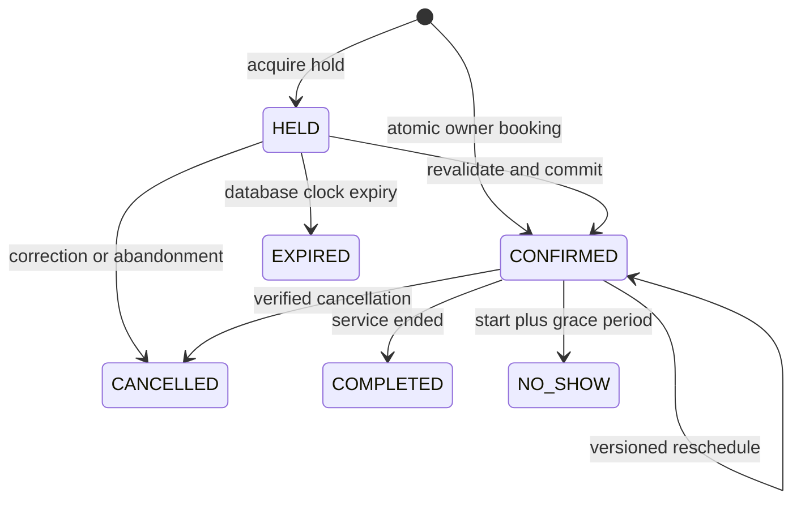

# Application API and conversation tools

These are this application's routes. Provider API routes are separate and live-verified only during activation. Browser clients use the same paths under `/api` on the dashboard; that server proxy forwards to Fastify. The voice controller calls the same booking domain functions inside the persistent backend, with a tenant-bound VOICE context. It does not use an owner cookie or a separate booking database.

## Request rules

JSON bodies reject unknown fields. IDs are UUIDs; telephone numbers are E.164. Date/time inputs are ISO 8601 instants with an explicit offset; displayed and spoken times use the location's IANA timezone. Local ambiguous/nonexistent DST times are rejected by the UI/intent adapter. Money is integer cents; duration/buffers are integer minutes.

Authenticated mutations require the session cookie, exact configured Origin and X-CSRF-Token. Booking/scheduling mutations additionally require `Idempotency-Key` matching `[A-Za-z0-9:_-]{8,120}`. Reuse the same key and payload after a timeout. A changed payload requires a new deliberate operation and key. A replay returns the stored HTTP status/body; it does not create another appointment. Redacted/expired responses retain a 410 tombstone. Optimistic writes require `expectedVersion`.

## Booking routes

| Method / path | Input | Result |
|---|---|---|
| `GET /v1/availability` | locationId, serviceId, optional staffId, from, limit 1–48 | Slots with exact start/end/staff/bay/timezone and display label; no reservation |
| `GET /v1/appointments` | from, to; at most 93 days | Appointment list and overlapping blocks, staff scope where applicable |
| `POST /v1/appointments` | locationId, serviceId, staffId, startsAt, customer{name,phone,notes}, notes | 201 authoritative confirmed receipt; owner/staff creation |
| `POST /v1/holds` | Same booking body | 201 HELD receipt, private hold token and reference; no message queued |
| `POST /v1/holds/:id/confirm` | locationId, holdToken, expectedVersion, readbackAccepted:true | 200 confirmed receipt after commit; expired/revised hold fails |
| `PATCH /v1/appointments/:id` | locationId, startsAt, staffId, expectedVersion | Atomic reschedule; original retained if conflict |
| `POST /v1/appointments/:id/state` | locationId, expectedVersion, state:CANCELLED/COMPLETED/NO_SHOW, reason | Committed state receipt; time/transition guards apply |
| `POST /v1/blocks` | locationId, resourceId, startsAt, endsAt, reason | Time-off/closure/resource block; rejects conflicting reservations |
| `DELETE /v1/blocks/:id` | locationId | Releases only that block, audited |

A conflict returns HTTP 409 with `error:"SLOT_CONFLICT"`, `committed:false` and `alternatives`. The current search returns up to three valid alternatives; it never invents three when inventory is exhausted. The strict 50-request test fixture has enough future inventory and requires exactly three. VERSION_CONFLICT means reload before a deliberate new operation. HOLD_EXPIRED is 410. A timeout or 5xx is not a booking receipt.

The database uses active `tstzrange [start-bufferBefore,end+bufferAfter)` claims for both staff and bay, protected by a GiST exclusion on tenant/resource/range. Short scheduling locks serialize the pilot location; constraints remain the independent safety boundary. Read-committed transactions, savepoints and version checks give deterministic conflict handling. Outbox rows are committed with the appointment; external side effects never run inside that transaction.

## Owner and operations routes

- Auth: `POST /auth/login`, `GET /auth/config`, `GET /auth/me`, `POST /auth/logout`.
- Catalog/bootstrap: `GET /v1/bootstrap`; `PATCH /v1/locations/:id`, `/v1/services/:id`, `/v1/resources/:id`; `PATCH /v1/settings`; `GET /v1/knowledge`; `PUT /v1/knowledge/:id`.
- Customers: `GET /v1/customers?search=...`, `GET /v1/customers/:id`; `POST /v1/customers/:id/consent`; `GET /v1/customers/:id/export`; `POST /v1/customers/:id/delete` with `confirm:"DELETE_CUSTOMER_DATA"`.
- Review: `GET /v1/calls`, `GET /v1/calls/:id`, `GET /v1/leads`, `PATCH /v1/leads/:id` with status OPEN/CONTACTED/CONVERTED/CLOSED.
- Operations: `GET /v1/operations`, `GET /v1/metrics`; `POST /v1/jobs/:id/retry` only for FAILED/BLOCKED. UNKNOWN is deliberately not retryable here.
- Google: `POST /v1/integrations/google/start`; callback `/integrations/google/callback`; `POST /v1/integrations/google/exceptions/:id/reconcile` with action RECHECK_GOOGLE or RESTORE_DATABASE_VERSION. A queued recheck is not a resolved exception.
- Simulator: `POST /v1/simulator/calls` with locationId; `POST /v1/simulator/calls/:id/actions` with actionId and a strict command. Simulations are clearly labeled in logs and metrics.
- Health: `GET /health/live`, `GET /health/ready`; readiness exposes no credentials or business records.

See the actual exported Zod contracts in `docs/contracts.json`; schemas in code are authoritative. API pagination beyond the bounded pilot list limits is not implemented. Staff UI, anonymous public booking and third-party integration credentials are later capabilities; they must still route scheduling through this domain.

## Voice/controller command definitions

| Command | Fields / allowed action |
|---|---|
| DETAILS | Optional serviceId, staffId, name, phone, from, notes; correct/review captured data; release old hold |
| AVAILABILITY | Optional from; query approved catalog and DB only |
| SELECT_SLOT | index 0–2 into the current saved options; acquire hold or prepare reschedule |
| CONFIRM | No supplied appointment result; controller verifies phase and telephone readback playback, then invokes the transactional command |
| CORRECT | Release stale hold; clarify revised details |
| QUESTION | topic of approved knowledge or catalog answer; no fabricated web knowledge |
| LOOKUP | phone plus 12-hex-character booking reference; bounded verification attempts |
| RESCHEDULE / CANCEL_APPOINTMENT | Requires a verified managed appointment and reviewed details |
| TRANSFER | Only configured business number; never caller-specified transfer destination |
| EMERGENCY | Decline emergency handling and give approved direction; no dispatch claim |
| END / DISCONNECT / SILENCE / UNSUPPORTED / ABUSE | Bounded recovery, lead capture, transfer or end; no successful-action fabrication |

Tool/action IDs are persisted per call and input hash. Replaying a completed action returns the previous result; changing its payload fails. A per-call workflow lease prevents overlapping controller actions. Ended calls cannot start new actions. Callers hear templates approved by the application, not arbitrary text from the intent model.

## Appointment state machine

Terminal appointments cannot be rescheduled or reactivated. The only terminal edit permitted by the guard is exact clearing of private notes for audited privacy redaction. Historical COMPLETED/NO_SHOW reservations remain allocated in the past; CANCELLED/EXPIRED reservations become inactive.
