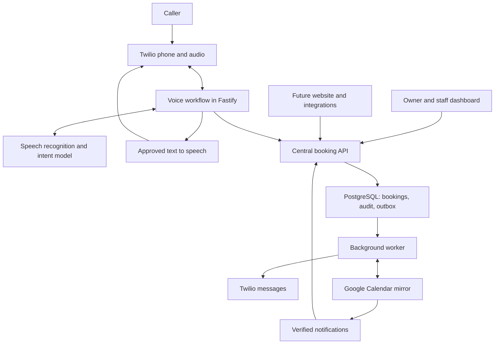
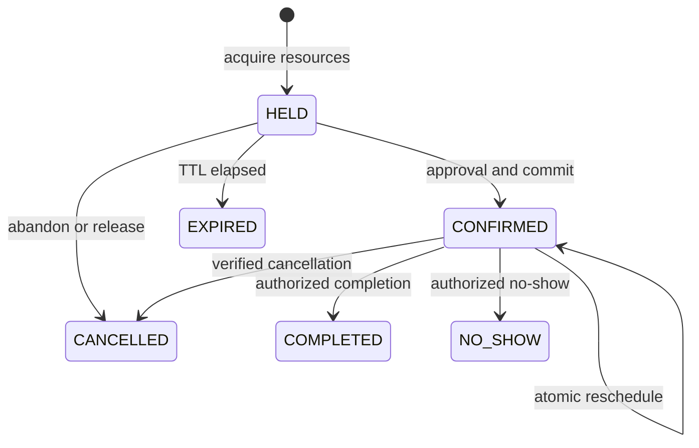

# AI receptionist: decision-ready product and engineering plan

Prepared September 21, 2026. Status: proposed design, awaiting implementation approval.

Provider facts below come from current official documentation. Product choices, budgets, performance targets, pricing proposals, and commercial forecasts are our estimates or requirements. No repository, integrations, production deployment, or tests have been implemented or exercised for this plan. The concurrency results described below are required outcomes, not observed results.

**1. Brutally honest executive assessment**

This is worth testing as a narrow, paid service for one kind of business. It is not yet a defensible horizontal SaaS company. Answering the phone with an AI voice is already a commodity; dependable scheduling, onboarding, and measurable recovered revenue are the product.

Your feature list is a small scheduling platform plus a telephone system, not a weekend chatbot. Two founders can build a credible supervised pilot. Calling it production-ready requires evidence from real calls, outages, restores, privacy controls, and customer support. Estimate 8–10 weeks to a limited paid pilot at roughly 30 focused hours per founder per week, followed by at least a month of observation. If both founders are learning backend transactions and audio systems, budget 12–16 weeks to reach that pilot gate. These are planning estimates, not delivery promises.

Three constraints are non-negotiable:

- Every booking writer must use our booking API. An owner making appointments directly in Google Calendar creates a second authority and defeats an absolute cross-system no-double-booking guarantee.
- A database can enforce one winner. A prompt cannot mathematically guarantee what a generative voice will say. The first pilot should use a controlled speech pipeline with server-rendered factual and transactional responses.
- Infrastructure below $300/month is realistic at pilot scale. A whole business—including legal review, development labor, support, and unrestricted usage—for $300/month is not.

Choose a fixed-location auto-detailing business with standard appointment packages, one initial technician and bay, and no established scheduling platform it refuses to replace. Exclude mobile detailing, custom restoration quotes, coatings requiring inspection, and fleet dispatch. This gives better potential revenue per recovered job than low-ticket appointments while keeping the scheduling rules manageable. This niche choice is a hypothesis to validate with a real owner, not a market finding.

The biggest strategic risk is building a competent booking system nobody wants to switch to. If the pilot insists on keeping an incompatible scheduler as its authority, change the integration strategy or change the pilot before building.

**2. Highest-risk assumptions**

| Assumption | Why it can kill the project | Evidence required |
|---|---|---|
| Owner will use one scheduling authority | Google, paper, and our dashboard cannot all independently promise the same capacity | Signed operating agreement; observe the owner booking all appointments through the API |
| Enough valuable calls are being missed | An impressive answer rate creates little value if callers would have booked anyway | Two-week baseline: call volume, missed qualified calls, completed jobs, contribution per job |
| Services can be scheduled deterministically | Vehicle condition, staff skill, travel, or shared bays can make a quoted duration wrong | Owner approves a short fixed service catalog, eligibility rules, durations, buffers, capacity |
| Callers tolerate the experience | Disclosure, accents, corrections, noise, and verification can increase abandonment | Consented test callers and pilot conversion compared with baseline |
| Two founders can operate the service | Support and bespoke configuration can consume the margin | By the third customer: onboarding ≤4 hours and routine support ≤30 minutes/customer/month |
| Providers are available on our accounts | Documentation does not establish our model access, quotas, OAuth approval, or messaging registration | Real account smoke tests before customer cutover |
| SMS can be enabled with the intended consent flow | Verbal permission alone may not meet a SaaS provider's downstream-user requirements | Approved documented opt-in flow; carrier registration and counsel/provider review |

**3. Five questions that materially affect the architecture**

1. Which actual business will pilot this, and is fixed-location auto detailing acceptable as the first niche?
2. What schedules its appointments today, and will the owner require every booking—including their own—to go through our system?
3. What capacity does each appointment consume: one employee, a bay or room, multiple employees, or variable-duration work?
4. What are its monthly inbound minutes and peak simultaneous calls, using phone records if available?
5. Where does the business operate, and what human-transfer coverage can it reliably provide?

Answers refine the plan; they do not block the defaults below. No real account connection or customer activation should use placeholder business details.

**4. Default assumptions so work can continue**

| Item | Planning default |
|---|---|
| Industry | Fixed-location auto detailing; standard packages only |
| Business | `[BUSINESS NAME]` |
| Location | Worcester, Massachusetts, USA; replace before onboarding |
| Timezone | `America/New_York`; store actual instants in UTC |
| Capacity | One technician and one bay; both must be available |
| Catalog | Three owner-approved services, with exact duration, price, eligibility, and buffers |
| Booking horizon | 60 days; 15-minute candidate start increments; actual overlap uses continuous time |
| Language | English |
| Calls | Inbound only; initially 300 minutes/month, three-minute mean, maximum five concurrent AI calls |
| Call coverage | Business hours first; after-hours booking enabled after its tests pass |
| Human fallback | `[PHONE NUMBER]`; staffed during agreed hours; otherwise a follow-up lead |
| Calendar | App-created Google calendar as a mirror; no independent appointment entry |
| Recording | Disabled; transient audio still processed and disclosed, transcript retention separately controlled |
| SMS | Confirmation plus one reminder, only for numbers with approved documented consent |
| Staffing | Two founders, approximately 30 focused hours/week each |
| Spend | Target approximately $231/month shared infrastructure, before tenant phone fees and usage |
| Pilot terms | Thirty days, supervised, capped usage, no automatic renewal |

**5. MVP requirements and explicit non-goals**

Must ship for the real pilot: inbound answering; AI disclosure; approved FAQs; name/phone/service/staff/date/time/timezone/notes capture; create, reschedule, cancel; final readback and explicit approval; expiring holds; database overlap constraints; consented SMS confirmation and reminder; Google projection and drift detection; owner calendar/list/manual operations; schedules and closures; customer history; call transcript, summary, deterministic outcome, tool history and follow-up; leads; allowlisted human transfer; audit; monitoring; export/deletion; restore and rollback runbooks.

Price and duration must come from the published catalog. An unusual vehicle or package goes to a quote/follow-up lead. The AI must not quietly turn an estimate into a fixed promise.

Build the central API to accept future website, staff, and integration clients, but postpone a separate public booking form and separate staff application. The responsive dashboard serves the owner and initial staff.

Explicit non-goals: payments or card capture on calls; medical/legal advice; emergency dispatch; regulated healthcare; outbound AI calling or cold calling; marketing SMS; full CRM; custom voice cloning; multilingual operation; mobile-route planning; bundles with variable capacity; group/class bookings; recurring customer appointments; marketplace discovery; automatic refunds; multi-location UI; arbitrary integrations; Kubernetes; microservices; vector database; autonomous browser actions.

Recordings, if later authorized, need a separate consent, retention, access, and deletion implementation. Do not add a recording switch that merely turns on a provider feature.

**6. Roles, user journeys, and acceptance criteria**

| Role | Allowed behavior | Acceptance criterion |
|---|---|---|
| Owner | Manage business settings, services, schedules, appointments, integration, exports, audit | Every mutation authenticated, tenant-scoped, permission-checked, audited |
| Staff | View assigned schedule; permitted appointment edits and time-off requests | Cannot access another tenant, alter billing/integrations, or silently override conflicts |
| Caller | Ask approved questions; book; change verified own appointment | Cannot list other customers, change policies, or supply a transfer destination |
| Voice runtime | Request narrowly scoped tools for one call | Business identity comes from trusted number mapping, never spoken instructions |
| Support operator | Time-limited, approved, audited support access | No routine unrestricted browsing of customer transcripts |
| Worker/integration | Process authorized jobs and observations | Cannot bypass the same booking-domain invariants |

New-booking journey: collect details → availability → short hold → complete readback → explicit caller approval → revalidation and database commit → confirmation speech → outbox dispatch. The success receipt contains an appointment ID, version, actual staff, local date/time/timezone, and committed status.

Owner journey: select service and resource → choose available start → save → receive confirmed appointment or a conflict with refreshed alternatives. Optimistic UI must say “Saving,” never “Confirmed” before the API succeeds.

Reschedule journey: verify caller → retrieve minimum appointment details → offer valid candidates → repeat changed details → atomically update the existing reservation. Failure preserves the original appointment. Cancellation requires verification and explicit confirmation before changing state.

Caller ID, name, and a claimed phone number are not authentication. Use an approved one-time verification flow for a previously verified channel, or a secret appointment-management code plus rate-limited verification. If neither is available, transfer or create a verification follow-up without revealing appointment details. SMS verification itself requires an appropriate consent basis.

**7. Recommended architecture with diagram**

One TypeScript monorepo, a modular Fastify backend, a Next.js dashboard, PostgreSQL through Supabase, and a background worker built from the same codebase. Separate processes are for audio responsiveness and durable jobs, not independently designed microservices.



The following is the architecture decision register. Costs are monthly USD planning amounts; shared items are counted once in section 18.

| Choice and purpose | Simpler alternative | Cost | Failure | Detection | Recovery |
|---|---|---:|---|---|---|
| TypeScript monorepo and shared contracts prevent client drift | Single backend with server-rendered pages | No license charge; engineering time | Contract divergence, dependency break | Contract tests, type checks, lockfile review | Roll back release; regenerate clients |
| Next.js dashboard supports familiar responsive forms and views | Basic admin CRUD panel | $7 initial hosting allowance | Stale views, failed saves | API errors and browser error reporting | Refetch; show pending/failed state; preserve form input |
| Fastify persistent backend owns call state, schemas, webhooks, API | Next.js-only backend | $25 compute allowance | Process crash, event-loop blocking | Health probes, audio gaps, event-loop and latency metrics | Carrier fallback; restart; reconcile persisted operations |
| Supabase Postgres plus Auth avoids operating databases and login infrastructure | Self-hosted Postgres and custom auth | $30 with Small compute; $100 PITR | DB outage, auth outage, bad migration | Probes, transaction failures, restore checks | Fail closed for writes; fallback phone routing; restore/reconcile |
| SQL range exclusion protects every resource | Unique start-time constraint | Included in DB; extra index/write work | Bad range calculation or missing resource claim | DB invariant/property tests | Reject write; fix function/migration; audit impacted bookings |
| PostgreSQL outbox and worker decouple messages/calendar from commits | Synchronous provider calls after save | $7 worker; no Redis initially | Worker crash, repeated jobs, ambiguous remote result | Queue age, retry count, provider reconciliation | Leases and backoff; dedup; manual review for unknown delivery |
| Chained speech with approved response templates gives control before audio leaves | GPT-Live direct SIP | Usage estimate in section 18; more audio integration work | STT error, slow turn, TTS error | Transcript/slot evaluations, stage timings, playback checks | Clarify; cancel stale speech; transfer; capture lead |
| Twilio Programmable Voice, Media Streams and SMS give one carrier integration | Owner phone forwarding and voicemail | Number plus voice/stream/message usage | Carrier outage, stream loss, spam spend | Call/stream callbacks and carrier status | Approved fallback routing, caps, owner recovery procedure |
| Google app-created calendar is a projection | No external calendar integration | Standard API use currently no extra charge; engineering work | OAuth revocation, lag, external edit | Sync watermark, reconciliation, drift exception | Retry, reconnect, repair projection; do not invent DB changes |
| Structured logs, error reporting, metrics and export backups | Local console logs | $20 combined allowance | Blind incidents or lost evidence | Synthetic checks; alert-delivery test | Independent alerts; reconstruct from persisted audit/outbox |
| Docker Compose and managed persistent hosting reduce environment drift | One manually configured VPS | Docker tooling $0; hosting below | Deployment interrupts sockets | Release smoke test; active-call counter | Drain calls; version rollback; carrier fallback |
| Owner-approved structured knowledge avoids retrieval complexity | Free-form prompt with business prose | Included in DB; no vector service | Stale or misleading business fact | Published version, expiry, owner review | Unpublish fact; answer “I don't have approved information” |

Fastify is chosen over NestJS to reduce framework surface for two founders; NestJS is reasonable if one founder already knows it well. Plain SQL migrations and a typed SQL query layer must preserve the exclusion constraints; ORM schema generation must not silently remove them. Versions will be pinned and official package APIs checked when implementation begins.

Hosting baseline is Render Pro for both founders, with always-on services. Its documentation supports WebSockets but warns that instance replacement closes them; therefore “zero downtime deployment” is not a promise of uninterrupted calls. [Render WebSockets](https://render.com/docs/websocket), [workspace plans](https://render.com/docs/platform-features-by-plan), [official compute comparison](https://render.com/articles/render-vs-railway).

**8. Voice and telephony design**

Verified choices as of this plan:

| Architecture | Quality and latency tradeoff | Reliability/control | Cost facts | Decision |
|---|---|---|---|---|
| GPT-Live 1 | Full-duplex spoken interaction; separate backend delegation | Strong fit for natural interruptions; direct audio still generated by a model | $0.05/session-minute, billed per second; backend usage separate | Evaluate after the controlled workflow; not the first pilot's confirmation authority |
| Realtime API, GPT-Realtime-2.1 | One session combines audio, reasoning and tools; needs task-specific evaluation | Fewer application stages, but less opportunity to inspect text before speech | Audio input/output $32/$64 per million tokens; text additional | Alternative voice adapter if evaluation justifies it |
| Realtime API, GPT-Realtime-2.1 Mini | Lower-priced alternative; quality/latency must be measured | Same application-side permission requirements | Audio input/output $10/$20 per million tokens; text additional | Benchmark, not automatically selected for safety-critical tasks |
| Chained STT → workflow → TTS | More stage latency; natural prosody but deliberately constrained wording | Exact approved text can be checked before playback; individual stages replaceable | Component pricing below | Recommended real-pilot architecture |
| GPT-6 Astra as live voice | Official model page says audio unsupported | Not an audio architecture | Standard short-context text input/output $10/$50 per million tokens | Development assistance; optional offline hard-case review only |

These facts are documented in the [voice architecture guide](https://developers.openai.com/api/docs/guides/voice-agents), [GPT-Live model page](https://developers.openai.com/api/docs/models/gpt-live-1), [pricing](https://developers.openai.com/api/docs/pricing), and [Astra model page](https://developers.openai.com/api/docs/models/gpt-6-astra). We have not benchmarked these models or verified access on your account.

Selected pilot pipeline:

1. Twilio receives the inbound call and authenticates our webhook interaction. A fixed greeting discloses AI and the approved transcription notice. No raw-audio archive is enabled.
2. `<Connect><Stream>` opens a bidirectional secure WebSocket to Fastify. Bind the validated call SID, receiving number, tenant and session to a server-issued capability. Never trust caller-supplied tenant IDs.
3. Stream caller audio to `gpt-live-transcribe`. Its official guide recommends it for realtime transcription. Use finalized turns for committing intent; provisional words may support the UI but never trigger writes.
4. A low-cost text model, initially `gpt-5.6-luna`, extracts a strict intent/slot proposal. It can identify FAQ IDs but cannot author arbitrary executable instructions. Evaluate it against a stronger model before increasing spend.
5. Deterministic code validates the proposal, asks a permitted clarification, invokes the central API, and selects a response template populated with trusted data. Approved FAQ text is selected from the published knowledge base. Unknown questions get a fixed fallback.
6. `gpt-4o-mini-tts` speaks only that approved text. Success wording requires a committed receipt and current appointment version. If strict exact acoustic rendering proves unreliable for names, digits or dates, use reviewed audio fragments or another tested TTS renderer for those fields.

The model does not receive a “say anything” channel. All factual/transactional speech goes through the renderer; the server cannot request a success template without the required receipt. This enforces application-level confirmation timing. Speech synthesis and recognition remain fallible, so acoustic output must also be evaluated—no marketing claim of zero possible speech errors.

[Realtime transcription](https://developers.openai.com/api/docs/guides/realtime-transcription), [Luna capabilities](https://developers.openai.com/api/docs/models/gpt-5.6-luna), and [streaming TTS](https://developers.openai.com/api/docs/guides/text-to-speech) establish the component capabilities. Prompting alone is not the control boundary.

Interruptions: detect caller speech while output is playing; stop TTS generation, send Twilio `clear`, invalidate the old response revision, and consume the correction. Track playback marks and distinguish played audio from cleared audio. Twilio expects base64 μ-law audio at 8 kHz; implement and test conversion from the selected speech provider format. Do not assume compatible codecs. [Twilio stream messages](https://www.twilio.com/docs/voice/media-streams/websocket-messages).

Initial timeout defaults: 8 seconds of silence → one check-in; another 12 seconds → offer human follow-up/end. At 2 seconds of tool waiting use a fixed non-confirming progress message; at 5 seconds investigate the operation's status rather than repeating a mutation. Limit AI conversation to 8 minutes, then offer transfer or follow-up. These values are tunable after evaluation.

Human transfer: owner-approved destination only; close/redirect the AI stream and use Twilio call control with a dial timeout and result callback. A ringing destination is not a successful transfer. Busy/no-answer returns to fallback or leaves a lead; do not claim someone will answer. Exclude arbitrary international/premium destinations and prevent forwarding loops. Human transfer incurs another call leg.

Direct SIP could simplify audio transport later. OpenAI documents GPT-Live SIP with TLS/SRTP, an incoming-call webhook, accept/reject actions, and a server sideband. Account enablement must be verified. If adopted, use client delegation to our existing workflow; never hand the voice provider unrestricted database tools. Direct SIP cannot provide our application the same pre-playback audio gate as the chosen bridge. [Telephony and SIP](https://developers.openai.com/api/docs/guides/voice-sip), [delegation](https://developers.openai.com/api/docs/guides/live-delegation).

**9. Booking concurrency and conflict-resolution design**

The invariant is: within a tenant, no active reservation may overlap another active reservation for the same exclusive resource. An appointment occupies every required resource, not just its employee. The initial detailing appointment consumes its technician and bay. A future shared employee keeps one resource identity across locations; location must not be included in the exclusion key in a way that permits simultaneous bookings elsewhere.

Store service start/end separately from the occupied range. For a service starting at 15:00, lasting 60 minutes, with 10 minutes before and 15 after, occupied time is `[14:50, 16:15)`. Half-open ranges allow a subsequent reservation starting exactly at 16:15. Buffers and duration are copied into the appointment snapshot, not read retroactively from an edited catalog.

Conceptual database invariant, to become a migration after approval:

```sql
CREATE EXTENSION IF NOT EXISTS btree_gist;

ALTER TABLE resource_reservations
  ADD CONSTRAINT no_resource_overlap
  EXCLUDE USING gist (
    tenant_id WITH =,
    resource_id WITH =,
    occupied_range WITH &&
  ) WHERE (active);
```

Add `NOT NULL` keys/range/active fields and checks rejecting empty, unbounded, reversed, or non-half-open ranges. The database function computes ranges from trusted service snapshots. Direct write permissions are revoked from browser roles; backend write paths use constrained database procedures. Include composite tenant foreign keys. PostgreSQL explicitly supports scalar equality plus overlapping-range exclusions with `btree_gist`; a unique start time is insufficient. [PostgreSQL range constraints](https://www.postgresql.org/docs/current/rangetypes.html).

Do not put `expires_at > now()` in a partial constraint. Time passing does not remove an index entry. Expiry must produce an explicit database mutation that releases the reservation.

New-booking workflow:

1. Read availability from Postgres using business hours, published service eligibility, staff/bay schedules, closures, lead-time policy, existing claims, and active holds. Return candidate timestamps and an `as_of` time. This is not a reservation.
2. `create_hold`: authenticate/authorize, register the request idempotency key, acquire the scheduling lock, expire relevant stale holds using database time, revalidate, then insert a `HELD` appointment and all resource claims atomically. Hold TTL is initially 120 seconds; one limited extension, total maximum 180 seconds. Rate-limit holds to prevent capacity starvation.
3. Repeat service, actual employee, full local date, time, named timezone, customer name and callback number. The server binds the readback and caller approval to a revision/hash of these exact details. Interruptions or edits invalidate that approval.
4. `confirm_hold`: obtain locks again, check the hold owner and token, check expiry using current database wall-clock time after waiting for locks, validate approval revision, revalidate schedules/policies and resource claims, and transition to `CONFIRMED`.
5. In the same transaction write audit events, a durable operation result, and unique SMS/calendar outbox jobs. Commit before returning a success receipt.
6. Only a successfully returned/reconciled committed receipt enables success speech. Workers only see committed outbox rows.

Pilot locking: a short transaction-scoped lock on the tenant/location scheduling row serializes schedule-affecting changes at this small scale. All appointment writes, holds, closures, resource blocks and imports follow it. The exclusion constraint remains the final independent defense. Transactions contain no model or external API calls. For future cross-location resources, replace the coarse lock with sorted resource locks, covering old and new resources during moves; keep the exclusion invariant unchanged.

Use `READ COMMITTED` with these locks and constraints initially. `SERIALIZABLE` is a valid alternative but introduces serialization retries and does not replace an explicit overlap constraint. Retry deadlocks or transient serialization errors with the same request key, bounded exponential backoff and jitter. Do not retry an actual slot conflict as if it were transient.

Exactly the Tuesday 3 PM race:

- If the owner commits first, the AI's hold/create fails with `409 SLOT_CONFLICT`; if the AI holds first, the owner cannot take that held interval.
- If the AI later confirms the valid hold, that booking wins. If it abandons the call, the hold expires and becomes available again.
- Two simultaneous final direct-create requests can yield exactly one confirmed appointment. Two simultaneous hold requests initially yield one hold—not magically a confirmed appointment. This distinction matters.
- Return three fresh alternatives for the same service and eligible staff/resource requirements, recomputed after the winning transaction is visible. If fewer than three exist in the permitted window, return the actual number and offer a wider search or lead.
- Never expose the winning customer's identity to the loser. A loser may choose a new option with a new logical request key.

Rescheduling: keep the original confirmed claims while discussing alternatives. On final approval, atomically update the existing appointment's ranges and resource claims with an expected-version check. A failed move rolls back to the original. The MVP does not create a second overlapping hold against the appointment's own original reservation; this avoids self-conflict and unnecessary complexity. The exclusion constraint evaluates the proposed final allocation against other appointments.

Idempotency and unknown outcomes:

- Use a unique `(tenant_id, operation, idempotency_key)` and normalized request hash. Same key/same request returns the original committed result; same key/different request is rejected.
- Retain mutation receipts for the supported retry horizon, initially 90 days. Never silently reuse a known expired request key. Client retries keep the original key; edits create a new revision/key.
- Tool execution also has `(call_id, tool_call_id)` uniqueness plus a server-side logical-action ID so a model repeating the same action with a new tool-call ID does not duplicate it.
- A timeout is not proof of rollback. Query the operation receipt on the primary database. If still uncertain, say the booking has not been verified and arrange follow-up. Do not offer that slot to someone else on the assumption it failed.
- Deduplicate webhook events before processing; persist the verified inbox event before acknowledging when possible. Use provider event identifiers, or a documented event-specific key when no universal delivery ID exists.
- SMS jobs are unique by appointment/version/message purpose/recipient. Calendar jobs are keyed by appointment/version/projection generation. Worker leases expire safely after crashes.
- Do not claim exactly-once delivery from a provider that has not documented an applicable idempotent send operation. A message-create timeout without a known provider SID becomes `UNKNOWN`; reconcile callbacks/provider records, then operator review. Blind retry can send duplicates.

Google Calendar policy:

| Event | Behavior |
|---|---|
| New confirmed appointment | Outbox writes a private, minimal calendar projection; UI shows pending/synced/error |
| Google write fails | Appointment remains confirmed in Postgres; retry projection and alert; do not send a second booking confirmation |
| Notification arrives | Verify known channel/resource/token, deduplicate, then fetch changes; notification is not appointment data |
| Push is missed or delayed | Poll incrementally and reconcile periodically; show last successful sync, not merely last webhook arrival |
| Expired sync token / HTTP 410 | Rebuild the external cache in staging and swap atomically; never wipe appointments or temporarily open occupied slots |
| App-owned event deleted or moved in Google | Flag drift; Postgres booking remains unchanged; repair projection and notify owner; deletion never implicitly cancels a booking |
| Unmanaged external busy event | Store original observation; normalize busy intervals; create resource blocks through the scheduling domain |
| External busy event overlaps an unconfirmed hold | In one scheduling transaction, invalidate the hold with an audited reason, release its claims, and apply the busy block; confirmation returns a conflict and fresh alternatives |
| External busy event overlaps a confirmed booking | Preserve the booking; record an exception and pause new affected-resource bookings pending owner resolution; never suppress the event or silently cancel a customer |
| Overlapping external busy events | Normalize their union before creating claims; raw observations may overlap and must not be forced directly into the exclusion-constrained table |
| External event deleted | Remove only that source's busy contribution after authenticated fetch; keep other overlapping sources |
| OAuth revoked | Mark reconnect-required; owner uses dashboard; if external busy feeds are required for safety, stop automatic bookings until refreshed |

For the default app-owned mirror, Google being offline need not stop valid Postgres bookings. For a future required external busy feed, stale data beyond a configured threshold—initially two minutes—does stop autonomous bookings. These are distinct modes, visibly configured.

Use stable valid Google event IDs derived from appointment ID plus projection generation; reconcile before retrying inserts, and track event ETags/version to reject stale updates. Use new generation IDs when a deleted projection cannot be recreated under the old ID. Avoid duplicate attendee invitations; pilot events have no customer attendees.

Google documents missing push notifications, expiring channels, incremental tokens and HTTP 410 recovery. Those mechanisms are eventually consistent; they do not create a transaction shared with Postgres. Even a fresh Google `freeBusy.query` has a check-then-write race. An owner booking independently in Google cannot receive our synchronous conflict response. [Push](https://developers.google.com/workspace/calendar/api/guides/push), [sync](https://developers.google.com/workspace/calendar/api/guides/sync), [event IDs](https://developers.google.com/workspace/calendar/api/v3/reference/events/insert), [free/busy](https://developers.google.com/workspace/calendar/api/v3/reference/freebusy/query).

**10. Appointment state machine**



| State | Capacity behavior | Transition rules |
|---|---|---|
| HELD | Blocks until explicitly released; cannot confirm at/after expiry | Bound to caller/session or owner request; not a booking promise |
| CONFIRMED | Blocks occupied interval | Requires successful final validation and commit |
| CANCELLED | Claims released | Terminal in MVP; rebooking is a new appointment |
| EXPIRED | Claims released | Terminal; cannot resurrect by retrying confirmation |
| COMPLETED | Retain historical interval; do not free still-relevant buffers early | Staff/owner action; reject premature completion in MVP |
| NO_SHOW | Preserve original reservation until its occupied interval ends | Authorized after configured grace period; no automatic early capacity release |

An expired hold can remain physically blocking for a short period until cleanup; never physically nonblocking while still confirmable. A worker scans regularly, and booking transactions clean relevant expired holds before evaluating them. Every status/range/resource change is audited by database-enforced transition logic.

Calendar status, message delivery, call outcome and appointment state are separate fields/state machines. A failed SMS cannot turn a confirmed appointment into a failed booking. Call outcomes include `BOOKED`, `RESCHEDULED`, `CANCELLED`, `FAQ_ONLY`, `LEAD_CAPTURED`, `TRANSFERRED`, `ABANDONED`, and `FAILED`; derive successful actions from receipts, not a generated summary.

**11. Database schema and relationships**

Use UUID identifiers, `timestamptz` for instants, IANA timezone identifiers, integer currency minor units with currency code, bounded text, explicit versions, and created/updated timestamps. Tenant IDs must be present in every business-owned row and in cross-table references.

| Table/group | Essential fields and relationships |
|---|---|
| `tenants`, `locations` | Business identity; location → tenant; timezone, address, language, booking mode |
| `memberships` | Auth user → tenant, role, permitted locations; unique membership |
| `staff`, `resources` | Staff → tenant; employee/bay resources; one identity for a shared employee |
| `services`, `service_staff`, `service_resource_rules` | Duration, buffers, price, currency, eligibility, effective version; allowed staff and required resource kinds |
| `business_hours`, `staff_schedules`, `closures`, `time_off` | Local recurring schedule rules and dated exceptions; approved by owner |
| `customers` | Tenant-scoped name, normalized E.164 phone, verification state; shared phone numbers do not prove identity |
| `consents` | Subject, channel/purpose, notice version, method, evidence reference, granted/revoked timestamps |
| `appointments` | Tenant/location/customer/service/staff, service snapshot, start/end, state, version, hold expiry/token hash, source/call ID |
| `resource_reservations` | Appointment or block → resource; occupied range, active flag; exclusion constraint |
| `resource_blocks` | Time off/owner block/external normalized busy source; reason and resource allocation |
| `booking_sessions` | Collected details, revision, readback hash, approval evidence, operation IDs, expiry |
| `idempotency_requests` | Operation/key/hash, status, durable result and appointment version; unique scoped key |
| `calls`, `call_events`, `transcript_turns`, `tool_executions` | Provider IDs, timing, redacted turns, inputs/results, versioned prompts/models, costs, outcome and follow-up |
| `leads` | Requested service/time, callback preference, reason booking failed, owner, next action, resolution |
| `knowledge_versions`, `behavior_versions`, `transfer_rules` | Published owner-approved facts, constrained greeting/settings, allowlisted destinations |
| `calendar_connections`, `calendar_projections` | Encrypted token references, scope/calendar ID, channel expiry/sync token, appointment/event mapping, ETag and applied version |
| `external_events`, `sync_exceptions` | Observed event versions/tombstones, normalized busy data, drift/conflict records |
| `webhook_inbox`, `outbox_jobs`, `message_deliveries` | Dedup keys, payload references, attempts/leases/due time, provider SID and delivery status |
| `appointment_events`, `audit_events` | Actor, reason, changed fields, old/new versions, correlation ID, database timestamp; append-only |

Tenant → locations/services/customers/staff; customer → appointments; appointment → several resource claims/events/jobs; call → several tool executions and zero or more linked appointments/leads. Customer history is a filtered query, not a separate CRM copy.

Do not copy raw transcript PII into the immutable audit trail. Audit records should reference the affected entity and minimal field changes. Erasure may pseudonymize subject references while preserving a legally justified non-PII integrity trail.

RLS applies to all tenant tables and private storage. Backend runtime roles must not casually use a Supabase service-role credential that bypasses RLS; use a dedicated least-privilege database role and explicit, transaction-local tenant context. Connection-pool reuse must reset that context. Any privileged procedure has a fixed search path, scoped authorization and narrowly granted execution rights.

**12. API and tool definitions**

These are proposed application APIs—not claims about provider endpoints. Generate an OpenAPI contract and typed clients from one schema source.

| Application route | Voice tool / client operation | Required inputs and result |
|---|---|---|
| `GET /v1/availability` | `get_availability` | Service, staff preference, date window; trusted candidate IDs, times, timezone, snapshot time |
| `POST /v1/holds` | `create_hold` | Candidate/details revision, request key; hold ID, expiry or conflict alternatives |
| `DELETE /v1/holds/{id}` | `release_hold` | Authorized hold; safe repeat release |
| `POST /v1/holds/{id}/confirm` | `confirm_booking` | Server-issued approval token, revision, customer details, key; committed receipt |
| `POST /v1/appointments` | Dashboard/direct booking client | Complete validated request and approval evidence; atomic create-and-confirm using same domain functions |
| `GET /v1/operations/{id}` | `get_operation_status` | Authorized operation reference; pending/committed/conflict/failed |
| `POST /v1/appointment-lookups` | `find_verified_appointment` | Verification capability; minimal matching data, no public enumeration |
| `POST /v1/appointments/{id}/reschedule` | `reschedule_appointment` | Expected version, new candidate, approval token/key; committed new version or preserved original |
| `POST /v1/appointments/{id}/cancel` | `cancel_appointment` | Expected version, approval/key; committed cancellation |
| `POST /v1/blocks` | Owner scheduling operation | Resource/time/reason; reject conflicts, no force override |
| `GET /v1/knowledge/answers` | `get_approved_answer` | Supported topic; approved answer ID/text/version or unsupported |
| `POST /v1/leads` | `capture_lead` | Minimal contact, consent, requested action, failure reason, key |
| `POST /v1/consents`, `/v1/verification/*` | Consent/verification UI and controlled workflow | Versioned notice, affirmative evidence and scoped challenge; no model-created proof of consent |
| `POST /v1/calls/{id}/transfer` | `request_transfer` | Rule ID and reason; destination resolved server-side |
| `/v1/settings/*`, `/v1/customers/*`, `/v1/calls/*` | Dashboard only | Role-scoped management and filtered history |
| `/v1/integrations/google/*` | Owner OAuth/status/reconnect | State-bound OAuth flow; encrypted server-side credentials |
| `/webhooks/twilio/*`, `/webhooks/google` | Provider ingress | Provider-specific validation, dedup and correlation |
| `/health/live`, `/health/ready` | Hosting probes | Minimal non-sensitive status |

Schemas reject additional properties; bound strings and search windows; validate UUIDs/E.164/timestamps/enums; resolve ambiguous local times before constructing UTC instants. A model cannot set tenant ID, price, duration, permission, staff eligibility, actual transfer number, or `status=CONFIRMED`.

Return a typed result envelope: `status`, `operation_id`, `appointment_id/version` when applicable, `error_code`, `retryable`, `as_of`, and safe alternatives. Typical outcomes: `201` new committed appointment; `200` idempotent replay; `409 SLOT_CONFLICT` or version conflict; `410 HOLD_EXPIRED`; `422` invalid details; `403` forbidden; `202 OPERATION_PENDING` for a known unresolved operation; `503` unavailable dependency. Do not turn unknown commits into `409`.

Use provider SDK operations documented for Twilio Messages and Call updates; Google `events.insert/get/update/delete/list/watch` and `freebusy.query` where permitted; OpenAI realtime transcription, Responses structured output, and speech generation. Pin SDK versions and verify concrete schemas in the integration milestone. No unverified endpoint payload is included here. [Twilio Messages](https://www.twilio.com/docs/messaging/api/message-resource), [Twilio Calls](https://www.twilio.com/docs/voice/api/call-resource), [Google event API](https://developers.google.com/workspace/calendar/api/v3/reference/events/insert).

**13. Owner-dashboard specification**

Use six compact sections rather than eighteen separate products.

| Section | MVP contents | Critical behavior |
|---|---|---|
| Today | Upcoming/current appointments, current availability, next actions, alerts | Pending saves and stale availability visibly labeled |
| Schedule | Day/week calendar, list, create/reschedule/cancel/block, staff schedules/time off/closures | Same booking API; no client-side “force booking”; conflict panel retains entered customer data |
| Customers | Search, contact details, consent, verified appointment history, limited notes | Tenant-scoped; minimum role access; no public search |
| Calls and leads | Transcript, concise summary, outcome, timeline/tool history, duration/cost, follow-up owner/status | Show “recording disabled” by default; generated summary cannot override action receipts |
| Operations | Google sync, delivery states, failed jobs, audit, usage/quality metrics | Distinguish confirmed appointment from failed notification/calendar projection |
| Settings | Services/durations/prices/buffers, staff, hours/holidays, knowledge editor, greeting/behavior, transfer rules | Draft/publish/version history; invariant safety rules cannot be removed by prompt editing |

Conflict panel: explain that the time is unavailable without revealing another customer; show the attempted service and time, three valid alternatives where available, refresh control, change-staff option when eligible, and create-lead action. Never discard the form or silently move the customer.

Metrics: total connected calls; AI-answered calls; completed bookings; eligible calls; lost leads; transfers attempted/connected; failures; mean duration; estimated usage and cost; cost/booking. Display definitions, date window, and estimated-versus-invoiced status. Start with polling every 5–10 seconds; live push is optional and never the booking correctness mechanism.

**14. Conversation scripts and failure flows**

These are draft product utterances for owner/counsel review, with all bracketed business details filled from trusted data.

| Situation | Spoken pattern | Required action |
|---|---|---|
| Greeting | “Thanks for calling [Business]. I'm its AI receptionist. [Approved transcription notice.] I can help with appointments or connect you to the team.” | Disclosure first; offer a human path; recording stays off |
| New booking | “Which service would you like?” Then ask only the missing details | Collect service, preference, date/time, name, callback, minimal relevant notes |
| Availability | “For [service] with [staff], I currently have [options] in [timezone]. Which works?” | Only use fresh API results; no guarantee until hold/commit |
| Final readback | “Please confirm: [service] with [staff], [weekday, month, day, year] at [time, timezone], for [name], callback [digits]. Shall I book that?” | Bind full readback to current revision; wait for explicit approval |
| Success | “Your appointment is confirmed for [committed details]. Your reference is [reference].” | Only after committed receipt; say text is queued, sent or delivered only when that state is known |
| Reschedule | “I'll keep your current appointment unless the new time is successfully booked.” | Verify; read back new details; atomic move; confirm new version |
| Cancellation | “Do you want me to cancel [verified appointment details]?” | Explicit approval; announce cancellation only after commit |
| General FAQ | Speak the approved answer or ask which listed service they mean | No internet search, guessed pricing, or inferred policies |
| Details change midway | “Got it—[corrected detail]. Let me check that again.” | Increment revision, invalidate prior approval, release/replace obsolete hold |
| Slot just taken | “That time was just taken. I can offer [three current options]. Which works?” | `409`; fresh valid alternatives; no fake apology followed by false confirmation |
| Hold expires | “The temporary reservation expired. I'll check that time again.” | Reacquire with a new action; never resurrect old approval |
| Tool timeout | “I haven't been able to verify the booking yet. Let me check its status.” | Reconcile operation key; no repeated create; if unresolved, human follow-up |
| Database unavailable | “I can't complete the booking right now. May I have your details for a follow-up?” | Fail closed; durable lead where available; carrier human fallback if backend is down |
| Calendar write fails after booking | “Your appointment is confirmed.” | The DB confirmation is valid; owner sees sync error; caller doesn't need backend jargon |
| Unsupported question | “I don't have approved information about that. I can ask the team to follow up.” | Lead/transfer; no improvised answer |
| Angry caller | “I understand you want this resolved. I'll try to connect you with the team.” | Transfer early; no arguing, concessions, or refund promises |
| Spam or abuse | “I can help with appointments. If that isn't what you need, I'll end the call.” | One boundary, then end if needed; rate limits; preserve minimal incident metadata |
| Human transfer | “I'll try to connect you now.” | Only report connected after provider evidence; no-answer becomes lead/fallback |
| After hours | “The team is closed now. I can book an available appointment or request a follow-up during [approved hours].” | Booking policy still enforced; don't promise an immediate callback |
| Emergency language | “This line cannot handle emergencies. If you are in immediate danger in the US, hang up and dial 911.” | No diagnosis, dispatch, or automatic emergency call; stop ordinary sales flow |
| Silence/noise/unclear name | “Could you repeat just [unclear field]?” | Two concise clarification attempts, spelling/digits or keypad where appropriate, then human option |
| Ambiguous date | “Do you mean Tuesday, [full date], at 3 PM Eastern?” | Resolve date/year/AM-PM/timezone; reject nonexistent DST time and clarify repeated time |
| Disconnect before commit | No speech possible | Expire/release hold; create follow-up lead if contact was captured; no automatic AI callback |
| Disconnect after commit | No speech possible | Keep appointment; consented notification still sends; mark announcement uncompleted and owner follow-up |

For readback, names and phone numbers are repeated carefully, not “corrected” by the model. On interruption, remove unplayed audio and reread affected details. Do not accept a “yes” from an old turn as authorization for revised details.

SMS draft, for a consented number only: “[Business]: [service], [date/time/timezone], [address]. Ref [reference]. Reply STOP to unsubscribe. [Approved help/management route].” A reminder rechecks state/version and consent at dispatch; cancelled or superseded appointments must not produce stale reminders. Keep templates short but budget segments rather than assuming one SMS.

**15. Security, privacy, and legal checklist**

| Control | Required implementation / verification |
|---|---|
| Authentication | Supabase Auth, secure HTTP-only session cookies, MFA for owners/admins, session revocation; no shared founder credentials |
| Authorization | Role/location checks per request; caller capabilities limited to one verified operation; service accounts scoped by function |
| Tenant isolation | RLS plus tenant-aware queries and composite FKs; cross-tenant negative tests including storage, logs, exports and workers |
| Transport/storage | HTTPS/WSS, verified DB TLS, managed encryption at rest; separately encrypt OAuth refresh tokens using managed secrets/envelope encryption |
| Secrets | Hosting secret manager, separate environments, rotation and least-privilege keys; never client bundles, prompts, logs, git, or `.env.example` values |
| Webhooks | Twilio SDK signature verification against correct external URL/body; OpenAI signature verification if its webhooks are enabled; Google channel token/resource matching and authenticated fetch |
| Input boundaries | Strict schemas, length/size limits, parameterized SQL, safe HTML/transcript rendering, CSRF protection, redirect allowlists |
| Abuse controls | Per-tenant/call/IP limits; caps on active holds, call minutes and concurrency; no arbitrary outbound destinations or URL fetching |
| Prompt injection | Treat caller speech, notes, transcripts and external event descriptions as data; no shell/browser/SQL tools; model proposes, server authorizes |
| Knowledge | Owner approval, fact/version provenance, no unapproved web answers; safety controls outside editable greeting/prompt |
| Logs | IDs and timing by default; redact authorization headers, tokens, OTPs, management codes and full phone numbers; restrict transcript access |
| Retention | Proposed defaults: transcript 30 days, leads 90 days, appointments/audit 12 months subject to owner/counsel policy; raw audio zero archive by default |
| Export/deletion | Authenticated owner request, scoped export, purge provider artifacts when supported, revoke tokens, delete storage, handle backup expiry and legal holds |
| Backups | Encrypted recovery and independent export; restore test; deletion tombstones reapplied after restore |

Google OAuth: prefer `https://www.googleapis.com/auth/calendar.app.created` for an app-created secondary calendar. It does not grant access to all existing personal calendars. Add `calendar.freebusy` only if owner-calendar busy visibility is genuinely required. Importing full existing event details requires broader event-read scope and a separate reason; selecting from a calendar list may require its read-only scope. No Gmail or Drive scopes. Encrypt refresh tokens, validate OAuth state/redirects, and complete the applicable Google verification/testing-to-production process. [Google scopes](https://developers.google.com/workspace/calendar/api/auth), [OAuth web-server flow](https://developers.google.com/identity/protocols/oauth2/web-server).

Twilio signature validation is required on both HTTP callbacks and the media handshake. Google Calendar notifications do not have the same HMAC signature mechanism: use its documented channel token and resource checks, and treat them only as triggers for authenticated fetching. [Twilio security](https://www.twilio.com/docs/usage/security), [Media Streams](https://www.twilio.com/docs/voice/media-streams), [Google push](https://developers.google.com/workspace/calendar/api/guides/push).

Call recording being off does not make live processing and saved transcripts legally irrelevant. Counsel must approve the disclosure/consent flow before real calls. A conservative approach is a fixed notice and an affirmative keypad response before enabling saved transcription, with a human alternative. If counsel determines a different lawful basis is appropriate, document it; do not secretly retain audio while calling the product “recording disabled.” Massachusetts law specifically addresses secret interception of communications. Interstate callers add jurisdictional issues. [Massachusetts Chapter 272, Section 99](https://malegislature.gov/Laws/GeneralLaws/PartIV/TitleI/Chapter272/Section99).

SMS has an important provider constraint: Twilio's current policy requires prior consent for informational messages and contains a prior-express-written-consent requirement when SaaS customers message downstream users. Do not assume a spoken “yes” resolves that. Default to an approved web opt-in with stored notice/evidence, or an existing auditable written opt-in. For a caller without that evidence, complete the booking verbally and give an optional public opt-in URL; do not send an unsolicited first link to obtain permission. Any keyword-based alternative needs provider/counsel approval. Implement A2P registration, clear business identity, STOP/HELP, all documented opt-out synonyms, consent revocation, and dispatch-time suppression. No marketing piggybacked on appointment messages. [Twilio Messaging Policy](https://www.twilio.com/en-us/legal/messaging-policy).

Our own deletion policy cannot promise immediate deletion from every provider system. OpenAI documents default abuse-monitoring retention up to 30 days, with endpoint-specific exceptions and account-dependent controls. Set applicable application-state storage off, minimize content, and disclose actual provider retention. Do not claim zero retention without verified account controls. [OpenAI data controls](https://developers.openai.com/api/docs/guides/your-data).

Qualified US attorney review list before pilot: call interception/recording/transcription across relevant states; AI disclosure and consumer-protection claims; transactional SMS/TCPA/state rules and carrier policy; privacy notice/DPA/subprocessors/data rights; security and breach notification; customer and employee information; accessible human alternatives; pilot service terms, outage handling, liability and insurance; ownership of phone number and customer data; founder equity/vesting/IP assignments; future use restrictions. This is a review checklist, not guaranteed legal compliance. Outbound calling stays out of scope.

**16. Testing and evaluation plan**

No tests have been run for this plan. Use a real PostgreSQL instance with actual migrations; do not replace it with SQLite or an in-memory mock for concurrency tests.

| Test family | Required scenarios |
|---|---|
| Unit/property | Range math, arbitrary durations/buffers, adjacent appointments, timezone/DST, schedule intersections, state transitions, consent and version rules |
| DB integration | Exclusion rejects raw overlapping writes; constraints survive migration; audit/outbox atomicity; expired hold cleanup; reschedule rollback; cross-resource conflict |
| API contracts | Schema rejection, roles, tenant boundaries, idempotency mismatch/replay, conflict envelope, stale revision |
| Webhooks | Valid/invalid signatures; raw-body/external-URL handling; duplicates, replay and out-of-order events; Google channel/token renewal |
| Booking E2E | Owner and caller same slot; owner first and AI first; corrections; cancellations; drop before/after commit; refresh while saving |
| Failure injection | Kill process before/after commit; lost HTTP response; worker crash after remote success; DB unavailable; expiry during lock wait |
| Google | 429/5xx, revoked OAuth, delayed/missing push, 410, deleted/moved event, external overlap, recurring/all-day busy events, reconcile after restore |
| SMS | STOP while reminder queued, segment count, invalid number, delivery failure, duplicate callback, ambiguous send with missing SID |
| Voice | Accents, slow/fast speech, stutters, background tools/traffic, speakerphone, interruptions, silence, names, repeated digits, “next Tuesday,” AM/PM and timezone |
| Security | IDOR/cross-tenant access, privilege escalation, prompt injection, SQL/XSS/CSRF, webhook forgery, secret scans, malicious transfer target, export isolation |
| Load | Fifty-request collision; unrelated resources; five concurrent real audio calls; worker backlog recovery; pool exhaustion |

Exact 50-request concurrency test specification, to implement after approval:

1. Create an isolated migrated test database; seed one business, one staff resource, one bay, one service and a future unoccupied interval. Seed three later valid alternatives.
2. Run two API processes against the same database to rule out reliance on a process-local mutex.
3. Prepare 50 authorized complete direct-create requests for the same service/staff/bay/time. Use 50 distinct idempotency keys and customer IDs; assign 25 an owner origin and 25 a validated voice origin.
4. Release all clients from one barrier and collect actual HTTP responses. Allow a defined healthy-test time budget; a timeout or 5xx fails this test rather than being counted as a conflict.
5. Require exactly one `201 CONFIRMED` and exactly 49 `409 SLOT_CONFLICT`. The winner may differ each run; the losing result class is deterministic. All losers receive available alternatives and no winner PII.
6. Query the database independently: exactly one confirmed appointment for that capacity, the expected two active resource claims, a complete audit chain, and exactly one logical confirmation job and calendar job for the winner. Zero confirmation jobs for losers.
7. Retry the winning request under its original key: same appointment ID, no additional effects. Retry all requests and inspect operation records.
8. Repeat 100 fresh rounds. Also run 50 simultaneous hold requests: exactly one `HELD`, 49 conflicts; explicitly confirm the winner and verify final confirmed state. Test expiry and abandonment separately.
9. Race cancellation, schedule closure, overlapping—not merely equal-start—bookings, and rescheduling. Verify different employees sharing a bay conflict and independent resources can coexist.

This test does not prove one confirmation under arbitrary outages: if every transaction is prevented from committing, zero may succeed. Safety requires at most one; the healthy-run acceptance test additionally requires one successful completion.

Voice correctness test: delay or reject the final booking transaction while capturing emitted text/audio event timing in a consented synthetic test. No success template or success audio may begin before the durable receipt is available. After commit, verify service/staff/date/time/timezone/name/phone in the rendered readback/confirmation. A broken database result must never be masked by a mock tool success.

Launch gates for the limited real pilot:

- 100 collision rounds meet the 1/49 result; zero overlap-invariant breaches in all tests.
- All critical failure flows pass; zero uncommitted booking confirmations in at least 200 scripted calls.
- At least 50 additional calls by consenting human testers across accents/noise; ≥95% completion on supported, unambiguous booking tasks; ≥99% correct critical fields after readback/clarification, with all mistakes reviewed.
- AI disclosure on 100% of connected AI test calls; zero unapproved policy/price statements in the evaluated corpus.
- End-of-utterance to first response audio: median ≤1.2 seconds, p95 ≤2.5 seconds for normal turns; final mutation acknowledgment p95 ≤3 seconds under five concurrent calls. This is an engineering target, not a claimed provider benchmark.
- Barge-in stops queued assistant audio p95 ≤350 ms; primary booking API p95 ≤500 ms under normal load and the separate 50-way stress run completes within 10 seconds.
- Expected human-transfer attempts connect ≥95% when the test destination is intentionally staffed; no-answer fallback works 100% in scripted tests.
- ≥98% of valid, opted-in test notifications reach delivered status within two minutes where the carrier provides delivery evidence; failures/unknowns visible within five minutes. Do not silently exclude failures from reporting.
- Normal Google projection lag p95 ≤60 seconds; all injected failures detected and repaired or marked actionable.
- No unresolved critical/high security findings; demonstrated cross-tenant rejection; a successful full restore drill and rollback drill.
- Observed pilot variable cost ≤$0.12/connected minute at the tested call mix; enforce tenant caps.

Finite tests do not prove a zero real-world error probability. During pilot, review every call outcome initially, with consented transcript review. Any false confirmation or cross-tenant disclosure immediately disables automatic booking until root cause and regression tests are complete.

**17. Deployment, monitoring, backup, and recovery**

Use separate production and development secrets and databases; local Docker Compose supplies app, worker and PostgreSQL. Seed synthetic businesses/customers. Staging calls use test numbers and documented tester consent. Do not copy production transcripts into development.

Release flow: CI type/schema checks → migration validation and critical tests → staged provider smoke test → build immutable images → backward-compatible database migration → deploy outside pilot hours → verify inbound call, booking, calendar and consented SMS → monitor. Destructive migrations need a tested migration/recovery plan. Use expand/contract changes so rolling back the app does not require deleting new customer data.

Repository shape after approval: `apps/dashboard`, `apps/api`, `apps/worker`, `packages/contracts`, `packages/booking`, `packages/voice`, `packages/integrations`, `db/migrations`, `db/seeds`, `tests`, and `ops`. Maintain `README.md`, `DECISIONS.md`, `STATUS.md`, and `.env.example`; record exact commands, observed results and blockers at every milestone.

| Signal | Measurement | Initial alert/action |
|---|---|---|
| Connection failures | Carrier accepted calls vs AI-session starts, by reason | >2% over meaningful rolling volume or two consecutive synthetic failures → fallback |
| Dropped audio | Stream disconnects, sequence gaps, unexpected playback starvation | Unexpected disconnect or repeated >2-second active-audio gaps → incident/follow-up |
| Voice latency | Speech end → response playback start, median/p95 | p95 >2.5 seconds for 15 minutes → investigate stage timings |
| Tool latency | Per tool, API, DB and provider spans | p95 booking >500 ms or repeated timeouts → check locks/pool |
| Booking success/conflict | Committed receipts vs eligible attempts; expected conflicts separate from failures | Unexpected failure rise; conflicts alone are not system outages |
| Duplicates | Inbox dedup counts and repeated side-effect identities | Duplicate effects >0 → stop affected dispatcher |
| Calendar health | Applied version, oldest pending job, last successful sync | Pending >5 minutes; unsafe required-feed staleness → pause affected bookings |
| Message delivery | Queued/sent/delivered/failed/unknown by provider SID | Failed/unknown queue age >5 minutes → owner action |
| Incorrect confirmations | Success playback without matching receipt/version | Any occurrence → automatic-booking kill switch |
| Transfers | Attempted, connected, busy/no-answer; eligible-call proportion | Track business-specific baseline; sudden increase or low answer coverage → review |
| Hallucinations | Human-labeled unsupported factual claims per reviewed factual claim | Any wrong price/policy/booking fact → remediate; model self-grading alone insufficient |
| Cost | Provider usage events reconciled to invoices; per call and per successful booking | 70/90/100% of cap; at cap approved human/lead fallback |
| Outbox/backups | Oldest ready job, lease failures, recovery-point age | Queue >60 seconds normally; recovery point beyond target → incident |

Structured logs carry request ID, tenant ID, call SID, conversation ID, tool-call ID, operation key reference, appointment/version, outbox job and provider event ID. Never place raw secrets or full transcripts into generic telemetry. Dashboard access and transcript reads are audited. Derived summaries are marked generated and can be corrected.

Health: liveness checks process/event loop; readiness checks necessary DB connectivity and capacity. Third-party outages should degrade the relevant function, not restart-loop a healthy backend. Durable jobs use PostgreSQL leases with `FOR UPDATE SKIP LOCKED`, bounded retries and dead-letter/operator review states.

Call-safe deployment: stop assigning new AI calls to the instance, drain active calls where possible, persist workflow state, then restart. Render allows shutdown delay up to 300 seconds, less than our maximum call length, so schedule pilot deployments when no calls are active or use carrier fallback during maintenance. Twilio Media Streams should not be assumed to reconnect seamlessly after a process death.

Backups: Supabase Pro with Small compute plus seven-day PITR is the recommended live-pilot floor. PITR replaces provider daily backups; create our own encrypted daily logical export separately, with backup monitoring and a restore drill. Target recovery-point objective ≤5 minutes and recovery-time objective ≤2 hours; these become promises only after measurement and agreement. Supabase requires at least Small compute for PITR. [Backup documentation](https://supabase.com/docs/guides/platform/backups).

Restore procedure: disable AI writes and message dispatch → restore into an isolated/recovered database → run invariant checks → compare post-recovery cutoff provider receipts and external copies → reconcile uncertain bookings and notify owner → reapply deletion/suppression tombstones → cautiously resume. Never replay all old SMS jobs blindly; providers may already have performed effects newer than the restored DB. A database backup is not an exactly-once side-effect backup.

Rollback: revert app image/model/prompt/knowledge version; keep committed bookings; disable the voice booking capability; route calls to the owner; replay only verified safe jobs. DB outage means no new “confirmed” bookings. Do not create a local-memory shadow booking system. The carrier fallback should be tested independently of the application host, and carrier-wide failure needs the owner's existing-line/voicemail contingency.

**18. Current cost estimate and unit economics**

USD, before taxes, currency conversion, carrier surcharges beyond the allowance, account-specific discounts, or additional usage. Pricing checked September 21, 2026. No provider subscriptions or numbers have been purchased.

Published provider facts:

| Item | Published price / behavior | Official source |
|---|---:|---|
| Twilio US local inbound | $0.0085/minute | [Voice pricing](https://www.twilio.com/en-us/voice/pricing/us) |
| Twilio local number | $1.15/month | [Voice pricing](https://www.twilio.com/en-us/voice/pricing/us) |
| Twilio Media Streams | $0.0044/minute | [Voice pricing](https://www.twilio.com/en-us/voice/pricing/us) |
| Twilio US/Canada standard outbound leg | $0.0140/minute; destination exceptions apply | [Voice pricing](https://www.twilio.com/en-us/voice/pricing/us) |
| Twilio long-code SMS | $0.0083 per inbound/outbound segment, plus carrier/registration fees | [SMS pricing](https://www.twilio.com/en-us/sms/pricing/us) |
| GPT-Live 1 | $0.05/session-minute; backend extra | [Model](https://developers.openai.com/api/docs/models/gpt-live-1) |
| GPT-Live-Transcribe | $0.017/audio-minute | [Model](https://developers.openai.com/api/docs/models/gpt-live-transcribe) |
| GPT-4o Mini TTS | $0.60/million input text tokens; $12/million output audio tokens | [Model](https://developers.openai.com/api/docs/models/gpt-4o-mini-tts) |
| GPT-5.6 Luna | Standard short-context input/output $0.20/$1.20 per million text tokens | [Pricing](https://developers.openai.com/api/docs/pricing) |
| GPT-6 Astra | Standard short-context input/output $10/$50 per million text tokens | [Model](https://developers.openai.com/api/docs/models/gpt-6-astra) |
| Supabase | Pro $25/month; Small compute $15/month with $10 compute credit; PITR starts $100/month | [Pricing](https://supabase.com/pricing) |
| Render compute | 512 MB instance $7/month; 2 GB instance $25/month | [Official comparison](https://render.com/articles/render-vs-railway) |
| Render team workspace | Pro $25/month flat; compute separate | [Pricing update](https://render.com/blog/better-pricing-for-fast-growing-teams) |
| Google Calendar | Standard usage currently no additional cost; quota/billing changes planned later in 2026 | [Usage limits](https://developers.google.com/workspace/calendar/api/guides/quota) |

Do not use old Twilio $0.004 Media Streams quotes: the fetched US page currently lists $0.0044. Do not treat text-model or TTS token prices as a fixed dollar amount per telephone minute. Real bills must include total processed context, silence where billed, output speech, retries, rounding, and extra call legs.

Shared infrastructure budget:

| Component | Monthly planning amount |
|---|---:|
| Supabase Pro plus Small compute, net of credit | $30 |
| Seven-day PITR | $100 |
| Render Pro workspace for two founders | $25 |
| API/audio process, 2 GB compute | $25 |
| Dashboard, initial 512 MB compute | $7 |
| Worker, initial 512 MB compute | $7 |
| Monitoring/error reporting allowance | $15 |
| Independent encrypted backup storage allowance | $5 |
| Authentication email allowance | $5 |
| Domain amortization allowance | $2 |
| Additional staging/database allowance | $10 |
| **Shared infrastructure total** | **$231** |

The last five amounts are allowances, not vendor quotes. The smaller instances must pass load/memory tests; raising the dashboard or worker to a larger tier adds cost. No claimed high-availability SLA is included. Additional projects, egress, build minutes, email and authentication features can exceed allowances.

Per business, initially budget $1.15/month for the number and $10/month for messaging registration/campaign-related recurring fees. The $10 is a reserve, not a universal A2P tariff. Registration depends on brand and campaign type; budget $25–$100 one-time until the actual registration path is quoted. Counsel, insurance and founder compensation are outside infrastructure. Obtain fixed legal quotes; reserve roughly $1,500–$4,000 for an initial focused legal review as a planning allowance, not a market-priced guarantee.

Conservative voice usage model for the chosen chain:

- Carrier plus stream: $0.0129/connected minute.
- Streaming transcription: budget a full audio minute for every connected minute, $0.017.
- TTS: use a planning allowance of $0.02 per spoken output minute; at 50% assistant speaking time, $0.01/connected minute. This is our estimate derived for budgeting, not a published flat TTS rate.
- Intent extraction/summary: allow approximately $0.002/connected minute for short contexts; measure total tokens over all turns.
- Transfers, extra processing, rounding and retry reserve: about $0.003/connected minute.
- Expected modeled total is about $0.045/minute. Use **$0.08/minute** for planning and **$0.12/minute** for stress, excluding SMS and fixed costs.

GPT-Live over the same carrier bridge starts near $0.063/minute before backend reasoning, extra transcription, transfers and overhead. Budget approximately $0.10–$0.15/minute pending measurement, not the advertised $0.05 alone. Realtime token billing needs measured speaking/context profiles; it must not be labeled a flat per-minute price.

For a three-minute call at the $0.08 budget: voice cost = $0.24. Assume 40% of all handled calls create a successful booking, two SMS per booked appointment, and two segments per SMS at a conservative $0.02/segment including carrier reserve. SMS = $0.08/booked appointment. Average variable cost/call = $0.24 + 0.40 × $0.08 = **$0.272**. Variable cost/successful booking, including nonbooking calls = **$0.68**. At $0.12/minute, those figures become **$0.392/call** and **$0.98/booking**.

These are scenarios, not predicted conversions. A lower booking fraction sharply raises cost/booking even if cost/minute stays flat.

Illustrative $399 plan, 600 used minutes/month, three-minute calls and 40% booking rate:

| Per-customer item | Amount |
|---|---:|
| Revenue | $399.00 |
| 600 minutes × $0.08 | $48.00 |
| 80 bookings × $0.08 SMS | $6.40 |
| Number plus campaign reserve | $11.15 |
| Routine support: 0.5 hour × $50 internal cost | $25.00 |
| Billing/collection reserve, rounded ≈3% | $12.00 |
| Direct service cost | $102.55 |
| Contribution before shared infrastructure | $296.45 |

At one customer, subtract $231 shared infrastructure: approximately $65/month remains before R&D, sales, legal, insurance and founder salaries. At ten similar customers on the same measured infrastructure capacity: $3,990 revenue − $1,025.50 direct costs − $231 shared infrastructure = **$2,733.50**, about **68.5% gross margin** including the support allowance. With two support hours/customer/month, the margin drops to about 49.7%. Hosting upgrades reduce it further.

Operating break-even in this scenario is one full-price customer, but that does not support two founders. Including $10,000/month combined founder compensation, `ceil((10,000 + 231) / 296.45)` = **35 customers**, before other overhead and growth costs. At two support hours/customer it is approximately **47 customers**. If these sound less exciting than “ten customers and freedom,” that is accounting doing its job.

For a 300-minute initial pilot, shared infrastructure $231 + phone/campaign $11.15 + voice $24 + illustrative SMS $3.20 ≈ **$269.35/month**, before test traffic, support and legal. A $20 test-usage reserve keeps it around $289.35. More usage can push the total bill over $300 even while infrastructure remains below the requested ceiling.

**19. Pricing and go-to-market plan**

Ideal first customer: an owner-operated fixed-site detailer with standard packages, roughly 1–3 workers, demonstrably missed booking calls, meaningful spare capacity, and willingness to use one scheduler. Prefer an accessible owner who will review daily results. Reject businesses whose jobs require unbounded quoting, dispatch, regulated advice, or an unsupported incumbent scheduling integration.

Pain/ROI: recover completed, incremental jobs and reduce owner interruption time. Measure qualified missed callers who become attended jobs; do not count every AI booking as recovered revenue. Example assumption: $100 contribution per incremental completed job; a $399 monthly fee requires four additional jobs to cover the fee. Ten incremental jobs yield $1,000 contribution before the fee, leaving $601. Validate contribution, available capacity and attribution with the owner's records.

Competition is already real. Goodcall advertises a $79/month Starter agent with 100 unique customers and unlimited minutes/tokens; Smith.ai currently shows paid tiers including $150/month and $500/month, with plan-dependent call allowances. Those are vendor offers, not evidence of equivalent transactional scheduling guarantees. Also compare the owner's existing online scheduler, voicemail/callback routine, and a human answering service. [Goodcall pricing](https://www.goodcall.com/pricing), [Smith.ai pricing](https://smith.ai/pricing/ai-receptionist).

Our differentiation must be a measurable, reliable workflow for this niche plus hands-on setup. “Uses a better model” will not sustain a premium. If an existing product solves the pilot's real problem at acceptable cost and reliability, reselling/integrating or choosing a different niche may be smarter than rebuilding it.

Proposed offers, to validate:

| Offer | Setup | Monthly | Usage |
|---|---:|---:|---|
| Supervised 30-day pilot | $250 | $199 | 300 connected AI minutes; explicit cap or separately agreed overage |
| Core | $499 | $399 | 600 minutes; $0.35 per additional minute |
| Higher usage | $750 | $599 | 1,200 minutes; $0.30 per additional minute |

Include two transactional messages per booked appointment within a stated fair-use/segment allowance; unusually heavy messaging or transfer legs are separately defined. Do not sell unlimited usage. No automated consumer payment collection is needed to test demand; manually invoice the business. A possible setup-fee waiver needs a three-month commitment priced to recover onboarding labor, not an open-ended free customization promise.

Onboarding: baseline call/job data → service/capacity mapping → written pilot terms → account and number ownership → knowledge/policy approval → privacy/consent flow → Google setup → seeded future appointments and blackout import → owner training → scripted real calls → baseline metrics → limited cutover with immediate rollback. Start with a test number or reversible forwarding; do not port the only business number before reliability is proven.

First ten customers, as a future plan—not authorization to send outreach now:

1. Interview ten local detailers; obtain one paid design partner with suitable scheduling practices.
2. Run one pilot for 30 days and publish no case study without permission. Build evidence of incremental completed jobs and error-free transactional handling.
3. Recruit customers 2–3 through that owner's introductions and local industry contacts; keep the identical service/capacity template.
4. Approach a bounded list of 30–50 similar businesses through founder-led visits or individually researched contact, subject to a separately approved outreach plan. Show the real owner/AI race, not only the friendly voice.
5. Add customers 4–10 in small cohorts. Stop onboarding when quality/support gates fail. Experiment with a referral credit after three retained customers; postpone paid ads until conversion and retention are measured.

The agreement must state pilot scope/hours, call and spending caps, central-scheduler operating rules, privacy/consent responsibilities, approved services and price data, escalation contacts, no emergency/regulated use, number and data ownership/export, termination/rollback, incident handling, liability/insurance terms, support boundaries, and whether any performance claims are permitted.

Support: founders cover an explicit business-hours window, proposed 8 AM–6 PM local weekdays; severe incidents get an immediate alert and target acknowledgment within 30 minutes during that window. Outside coverage, automatic fallback protects the business. Do not advertise staffed 24/7 support because an AI answers at night. Changes to hours/prices are owner-editable; bespoke logic has a written scope and fee.

Commercial KPIs: eligible-call booking rate, incremental completed jobs, owner minutes saved, qualified lead recovery, caller abandonment, transfer success, harmful error count, effective cost/booking, support time, onboarding hours, paid conversion, 30/90-day retention and contribution margin.

**20. Three-stage roadmap**

| Stage | Scope | Exit decision |
|---|---|---|
| Demo | Synthetic business; real Postgres constraints; owner/AI race; basic dashboard; consented test telephone calls and sandbox-calendar actions | Demonstrates the central invariant and a usable conversation; no claims of production readiness |
| Real customer pilot | One business/location/timezone/language; standard packages; real carrier, OAuth and consented messages; backups, privacy, monitoring and human fallback | Thirty days of measured safe operation and a customer willing to continue at sustainable pricing |
| Production SaaS | Repeated onboarding, demonstrated tenant isolation, multi-customer operations, billing/usage limits, audited support, scale/recovery tests and reviewed contracts | Several paying retained customers with repeatable economics; expand features only from evidence |

Schema readiness for multiple tenants is required now; operational multi-tenant readiness is not established until tested. Multi-location UI, complex resource allocation, integrations and additional languages follow demonstrated customer demand, not a calendar date.

**21. Week-by-week implementation plan for two founders**

Founder A owns database/backend/security/reliability. Founder B owns voice/dashboard/integrations/customer onboarding. Both review booking changes; neither independently invents state-transition rules.

| Week | Founder A | Founder B | Evidence/gate |
|---|---|---|---|
| 1 | Repo, contracts, Docker, schema, threat model | Pilot interview, catalog, phone/API account feasibility, consent/legal tasks started | Approved requirements; real provider access checks; no unresolved single-authority disagreement |
| 2 | Holds, exclusions, idempotency, audit/outbox | Owner create/list and visible conflicts | 50-way test, owner/AI logical race, buffer and tenant tests pass |
| 3 | Atomic reschedule/cancel, scheduling rules, verification | Calendar/list UI, schedules/closures/services | Booking-domain milestone complete; no voice dependence |
| 4 | Voice permission adapter, persistent call workflow | Real inbound audio, transcription, TTS, interruption control | Real telephone transcript and measured latency; no mocked success |
| 5 | Approval/readback receipts, timeout/disconnect recovery | Full scripted booking/FAQ/failure flows; transfer | Voice confirmation-order and human-transfer tests pass |
| 6 | Google projection/inbox/outbox reconciliation | OAuth/status UI; SMS consent and delivery integration | Real Google writes/deletes and consented SMS; duplicate/failure tests |
| 7 | Auth/RLS/security, metrics, backups, restore | Calls/leads/audit/settings polish; knowledge publication | Security, restore, export/deletion and monitoring demonstrations |
| 8 | Fault/load/concurrency and rollback drills | Human voice evaluations; owner training and cutover rehearsal | Launch criteria report with actual results and known limitations |
| 9 | Fix pilot-only defects; observe operations | Limited business-hours paid pilot | Daily review; expansion only after stable week |
| 10 | Improve recovery/support automation | Carefully enable agreed after-hours coverage | Pilot continues toward 30-day review; assess paid renewal |

OAuth verification, SMS registration, legal review and owner responsiveness can dominate elapsed time; start them in week 1. The schedule is gated, not permission to ship a failed milestone on Friday. If constrained to nights/weekends, stretch the calendar rather than deleting verification.

**22. Prioritized backlog**

| Priority | Work |
|---|---|
| Must | Approved pilot scope; central database/API; exclusion constraints; correct durations/buffers/resources; expiring holds; full readback and consent revision; atomic reschedule/cancel; idempotency; unknown-commit reconciliation; audit/outbox; authentication/RLS; basic owner operations; actual inbound voice; interruption handling; approved facts; human fallback; lead capture; Google projection/reconciliation; consented confirmation/reminder; logs/metrics; backups/restore; critical security and concurrency tests |
| Should | Better pronunciation dictionaries; keypad fallback; appointment-management verification link; additional owner UX; richer call-quality review; queue replay UI; cost reconciliation; scheduled consent/retention jobs; automated channel renewal checks |
| Could | GPT-Live evaluation; richer charts; embeddable booking form; additional fixed-package niches; owner digest; simple waitlist |
| Not Now | Multiple live voice architectures in production; outbound AI sales; payments/cards; healthcare; emergency dispatch; CRM; cloning; multilingual/multi-location UI; custom mobile apps; autonomous web actions; complex dispatch; microservices; Kubernetes; vector retrieval; broad paid marketing |

Core staff schedules, time off, and all requested operational dashboard data remain Must; postpone polish, not booking correctness or owner visibility.

**23. Definition of done for every major milestone**

| Milestone | Done means | Evidence retained |
|---|---|---|
| M0: pilot contract and feasibility | Scope/capacity/single-authority agreed; provider access checked; consent/legal blockers listed with owners | Decision log, signed pilot terms before activation, account smoke-test results |
| M1: booking core | Actual migrations; exclusion, holds, transitions, audit, idempotency and atomic reschedule proven | DB test logs; repeated 1/49 concurrency results; independent invariant query |
| M2: owner workflow | Owner manages real test appointments, availability, staff, services and closures through central API | E2E results, screenshots, conflict/reschedule demonstration |
| M3: telephone workflow | Real inbound call completes every supported flow; no precommit success audio; interruptions/timeouts/transfers tested | Correlated provider IDs and timestamps; consented test transcripts/audio where allowed |
| M4: integrations | Real Google sync and SMS delivery; duplicate/unknown/failure paths visible and recoverable | Event/message IDs, retry/reconciliation results; no mock-success screenshots |
| M5: launch operations | Security/tenant tests, backup restore, rollback, alerts, export/deletion and caps pass | Launch checklist with measured numbers and restore/incident runbooks |
| M6: paid pilot | Thirty days reviewed; harmful errors resolved; ROI and support cost measured; owner can decide on renewal | Pilot report, actual usage/costs, owner feedback and paid continuation decision |
| M7: repeatable SaaS | Several paying businesses onboarded from a template; operational tenant separation, billing, support and recovery validated | Cohort retention/margin, onboarding hours, access audit and scale-test results |

Every implementation milestone updates `README.md`, `DECISIONS.md`, `STATUS.md`, `.env.example`, relevant migrations and seed data. Run the meaningful tests for the changed behavior and required gates; show exact observed outcomes. A feature is “implemented” only after it is exercised, and “verified with provider” only after the real provider path succeeds. Surface blockers immediately and stop dependent work that would otherwise pretend success.

**24. Final recommendation: pursue, pivot, or stop**

Pursue one paid pilot. Do not spend months constructing a general receptionist platform before proving that one owner will trust the schedule and pay for the result.

Continue when the owner follows the central scheduling rule, the safety gates hold, at least five paying customers can be found in the same niche, most initial pilots renew at full price, measured customer benefit is plausibly at least twice the fee, and steady-state gross margin can exceed 65% after support and infrastructure.

Pause automatic booking immediately after a false confirmation, resource-overlap breach, or material cross-tenant disclosure. Repair and re-evaluate before resuming; do not call it an acceptable pilot learning cost.

Pivot toward an integration with an established scheduling authority if most qualified businesses refuse replacement, provided its API can actually enforce equivalent booking invariants. Alternatively sell lead capture/qualification with human-approved booking, but explicitly revise the product promise. A second calendar pretending to be a source of truth is not a solution.

Stop this niche if, after about 20 qualified owner interviews and three well-run pilots, there is no sustainable willingness to pay or recovered-job value is too small. Stop promising SaaS margins if each customer needs weekly bespoke engineering.

**Approval boundary:** this document proposes the design and test specifications only. The next authorized implementation unit should be M0/M1: a clean repository, local PostgreSQL, migrations, the central booking API, and the real concurrency tests. No phone-number purchase, external booking, customer messaging, account connection, or deployment has been performed. Wait for approval before writing product code.
