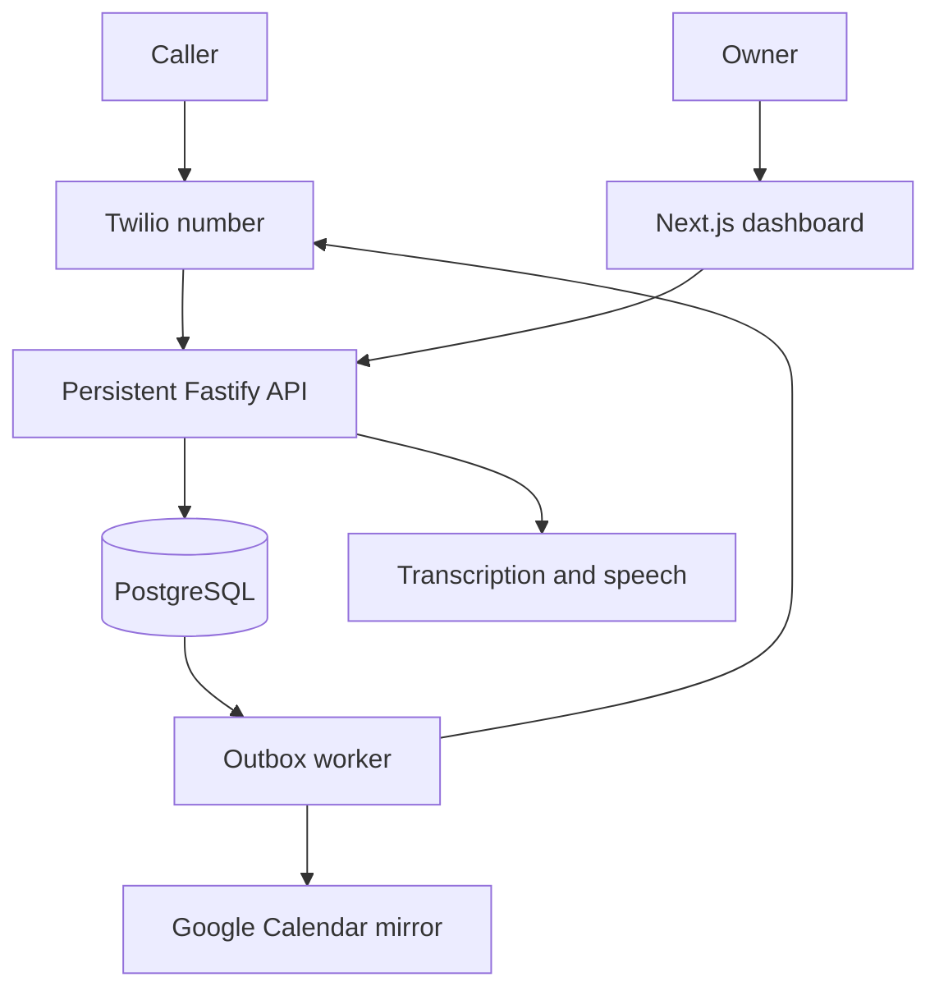

# Deployment runbook

No deployment has occurred. These are reviewable configuration instructions and container definitions, not evidence of a successful deployment. Use a separate staging database and real provider test accounts/numbers before serving customers.

## Hosting topology

Use one region near the pilot, one API instance, one worker and one dashboard initially. The API and worker may later scale, but one instance is sufficient until measured capacity says otherwise. The database is always central. No dashboard, worker, voice model or calendar receives authority to bypass booking rules.

The current recommendation is paid Render web services for API and dashboard plus a background worker, with managed PostgreSQL and Supabase Auth. A free sleeping HTTP service is unsuitable for telephone pickup. Render supports public WebSockets, but replacing an instance closes its connections. Schedule pilot deploys outside staffed call windows and route calls to a human first. [WebSockets](https://render.com/docs/websocket), [web services and PORT](https://render.com/docs/web-services), [health checks](https://render.com/docs/health-checks), [Docker](https://render.com/docs/docker), [free-service spin-down](https://render.com/docs/free). Official docs checked 2026-09-22; no hosting purchase made.

## Prepare PostgreSQL and authentication

1. Create separate staging and production databases. Disable public direct database APIs for these application tables. Restrict network access, require validated TLS, enable daily backups, and select PITR according to the signed recovery objective.
2. Create `receptionist_app LOGIN NOSUPERUSER NOCREATEDB NOCREATEROLE NOINHERIT NOBYPASSRLS` using a generated private password. Use a separate trusted migration owner. Runtime credentials must not own tables; startup verifies this. Avoid transaction poolers that change session assumptions until specifically tested; a direct or session-pooled connection is the initial choice.
3. Supply `MIGRATION_DATABASE_URL` only to the migration/provisioning task, then run `npm run db:migrate`. The process holds an advisory migration lock and rejects edited applied migration hashes. `btree_gist` must be available.
4. Create the owner in Supabase Auth with asymmetric JWT signing/JWKS enabled. Disable public self-signup for the pilot. Set trusted `app_metadata.tenant_id` using the provider's admin tooling after provisioning. Do not place this value only in user-editable metadata. Review MFA and account recovery before production; MFA UI is not implemented here.
5. Copy `ops/pilot.example.json` outside the source tree, replace every field with reviewed business data, and run `npm run provision:pilot -- /private/path/pilot.json`. It creates the pilot, owner membership, resources, catalog and phone route in one transaction; it leaves live approval false. It does not create an Auth user or purchase a phone number.
6. Supply the returned tenant UUID in `WORKER_TENANT_IDS`, set the Auth user's trusted metadata, and exercise actual sign-in. After changing accounts or roles, check that membership revocation immediately denies the application session. Local owner access must be disabled.

## Service configuration

| Service | Build / start | Secrets and environment | Health |
|---|---|---|---|
| API | `ops/Dockerfile.api`; default `npm run start:api` | Runtime DB URL, TLS, Supabase URL/anon key, session/encryption secrets, provider credentials, flags, HTTPS public API/dashboard URLs, tenant IDs | `/health/ready` checks DB; `/health/live` checks process |
| Worker | Same API image; override command `npm run start:worker` | Runtime DB URL, shared crypto/session configuration, provider credentials and same flags/tenant IDs | Monitor successful worker ticks, queue age and logs; background process has no public listener |
| Dashboard | `ops/Dockerfile.dashboard`; default start script | `API_INTERNAL_URL` only; no database, OpenAI, Twilio or Google secrets | `/` plus authenticated synthetic HTTP check in staging |
| Migration job | API image; override command `npm run db:migrate` | Migration URL and TLS only | Exit code; inspect recorded migration hashes |

Set `API_HOST=0.0.0.0`. The API reads `API_PORT`, then the hosting `PORT`; remove a local hardcoded `API_PORT` when allowing the hosting port. The dashboard start script reads `PORT`. Use the API's real public HTTPS URL without a trailing slash for webhook signature canonicalization. The dashboard origin must exactly match the user's public origin. Do not set `NEXT_PUBLIC_*` secrets.

Do not put secrets into Docker build arguments. The `.dockerignore` excludes `.env`, generated data, node_modules and evidence. Containers run as a non-root account. The images and Docker Compose workflow are supplied but **not built or exercised in this environment**, which has no Docker daemon.

## Rollout and rollback

1. Run CI: type checks, all native DB tests including 100×50 contention, build, dependency audit and browser E2E. A skipped contention test is a failed release gate.
2. On staging, complete `docs/ACTIVATION.md` and `docs/TESTING.md`. Save dated artifacts and reviewers in a private `release-evidence.json`. Readiness is not a substitute for these tests.
3. Take/verify a backup, run additive migrations, deploy with voice/SMS disabled, run health/auth/booking checks, connect the owner's dedicated calendar, then enable the reviewed pilot flags and `approved_for_live` for that tenant.
4. Route the pilot number only after a real call, transfer, conflict and message have been checked. Keep the founder on call during the agreed staffed hours.
5. Rollback trigger: any uncommitted spoken confirmation, overlap, unauthorized data access, persistent 5xx, or broken call routing. Disable live voice and SMS; forward the number to the human or Twilio fallback. Preserve database bookings and logs. Roll back the application image to the previous version. Do not run destructive down migrations over customer data.
6. Reconcile ambiguous provider actions before resuming. A database restore must not blindly replay messages that may already have been sent.

## Recovery objectives

Proposed pilot targets: RPO ≤15 minutes only if a managed PITR plan actually provides it; RTO ≤4 hours during staffed support. A daily snapshot alone means an RPO potentially near 24 hours. Choose and disclose the actual plan before signing these targets. Restore drills are a launch blocker; see `docs/OPERATIONS.md`.
